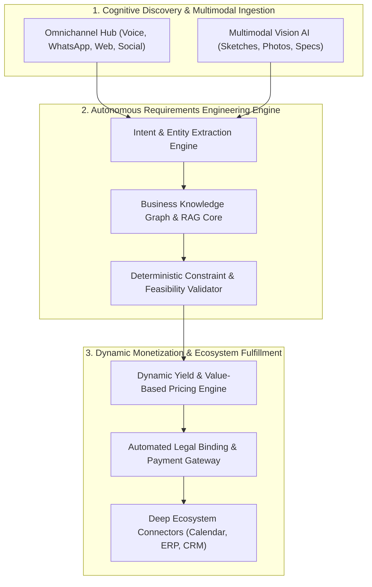

# Strategic Grand Vision: Universal AI Pre-Sales, Scoping & Pricing Platform
## Democratizing Autonomous Requirements Engineering & Dynamic Pricing for Bespoke Services

> [!IMPORTANT]
> **STRATEGIC HORIZON DIRECTIVE:**
> This document articulates the long-term technological and commercial vision of the venture, extending far beyond the current single-tenant Minimum Viable Product (MVP). It outlines the blueprint for a universal, horizontal **No-Code B2B SaaS platform** designed to eliminate friction in high-touch, custom service transactions across industries.

---

## 1. Executive Summary & Core Objective

In traditional commerce, transactions are binary: products sit on shelves with static price tags, and checkouts occur instantaneously. In contrast, **bespoke services and custom manufacturing**—representing hundreds of billions of dollars across global SMBs—suffer from a crippling structural inefficiency: **the Pre-Sales Bottleneck**.

Before a transaction can close, every prospective client requires a time-consuming, multi-turn "discovery and requirements engineering" process:
* Gathering multidimensional constraints (dimensions, dates, guest counts, aesthetics, raw materials).
* Validating operational feasibility and inventory availability.
* Calculating complex, multi-variable pricing models.

Most small and medium-sized businesses (SMBs) lack dedicated sales engineers or estimators. Consequently, highly skilled artisans, musicians, consultants, and contractors spend 30% to 50% of their working hours manually fielding inquiries, drafting speculative estimates, and chasing leads that never convert.

### The Mission
To build an **autonomous, No-Code AI Pre-Sales & Scoping Platform** that allows any custom service business to deploy a production-grade AI Sales & Requirements Engineer in under ten minutes. The agent autonomously ingests the business's operational DNA, pricing matrices, and technical constraints, actively converting raw interest into confirmed, legally binding, and fully costed contracts 24/7.

---

## 2. Platform Architecture: The Three Cognitive Pillars

The platform moves beyond superficial chatbots by fusing three decoupled systems into a unified operational loop:



### Pillar I: Zero-Friction Multimodal Ingestion
* **Natural Language Understanding across Modalities:** Prospects rarely express their needs in structured tables. The agent ingests unstructured prose, conversational voice input, inspiration imagery, and handwritten sketches.
* **Proactive Guided Discovery:** Rather than passively awaiting commands, the agent conducts structured requirements interviews, asking targeted clarifying questions to eliminate ambiguities before pricing.

### Pillar II: Grounded Deterministic Verification (Zero-Hallucination)
* **Generative Dialogue vs. Deterministic Rigor:** The system strictly decouples natural language interaction (LLM-driven) from operational truth (deterministic rules engine).
* **Hard Feasibility Gates:** Availability, operational safety limits, geographic radius, minimum viable budgets, and regulatory requirements are computed mathematically, completely insulated from LLM hallucinations.

### Pillar III: Autonomous Closing & Workflow Orchestration
* **Human-in-the-Loop Transparency:** Generates real-time price ranges for prospective buyers while compiling exhaustive, auditable cost breakdowns (materials, labor, logistics, overhead) for business owners.
* **Instant Conversion:** Triggers digital contract execution (e.g., DocuSign, PandaDoc) and captures upfront deposits via integrated payment rails immediately upon proposal acceptance.

---

## 3. Market Expansion & Scalability Matrix

The platform is horizontally architected to onboard any industry characterized by **high customization, multi-parameter scoping, and variable pricing**:

| Industry Sector | Target Verticals | Scoping & Requirements Complexity | Business Value & ROI Impact |
| :--- | :--- | :--- | :--- |
| **Events & Entertainment** | • Wedding & Corporate Bands<br>• Event Venues & Banquet Halls<br>• Custom Catering & Private Chefs<br>• Event Designers & Lighting Crews | Dynamic date availability, guest scaling, venue acoustics/power specs, multi-tier musician lineups, travel logistics. | Recaptures lost nighttime/weekend leads; prevents date double-booking; reduces quote turnaround from 48h to 90 seconds. |
| **Bespoke Manufacturing & Craft** | • Custom Cabinetry & Furniture<br>• Architectural Woodworking<br>• Bespoke Jewelers (Engagement Rings)<br>• Metal Fabricators & Pergola Builders | Material grade identification (e.g., Pine vs. Walnut), 3D space dimensions, finish requirements, production lead times. | Eliminates dozens of unpaid site visits; automates BOM (Bill of Materials) estimation; filters out budget-mismatched clients. |
| **Architecture & Remodeling** | • Interior Designers & Home Stagers<br>• General Remodeling Contractors<br>• Landscape Architects & Pool Builders | Floor plan interpretation, structural constraint checks, municipal permit evaluation, multi-phase milestone schedules. | Automates the initial design brief; aligns client aesthetic vision with realistic construction budgets upfront. |
| **Specialized B2B Services** | • Custom Software Development Agencies<br>• Boutique Branding & Design Studios<br>• Management & Compliance Consultants | Technical architecture scoping, feature matrix estimation, hourly vs. fixed-fee models, regulatory compliance constraints. | Standardizes proposal engineering; qualifies enterprise procurement requirements before developer involvement. |

---

## 4. Advanced Capabilities in an Unconstrained World

When scaled with frontier AI infrastructure and enterprise ecosystem access, the platform unlocks next-generation capabilities:

### 4.1 Ultra-Low Latency Conversational Voice AI
* **Sub-500ms Full-Duplex Voice:** Voice agents capable of handling live telephone calls with human cadence, natural interruptions, backchanneling ("I understand", "Got it"), and emotional intelligence.
* **Dynamic Persona Calibration:** The business owner configures brand identity via simple natural language sliders—ranging from formal and prestigious (haute horlogerie, law firms) to warm, lively, and colloquial (local wedding bands, creative agencies).
* **Omnichannel Persistence:** A client can initiate an inquiry via WhatsApp, clarify spatial specs over a 5-minute phone call, upload inspiration photos on Instagram DM, and receive the finalized quote via email—all maintaining one persistent conversational state.

### 4.2 Multimodal Vision-to-BOM Engine
* **Visual Spatial Deconstruction:** A client uploads an image of a custom outdoor seating area or dining table from Pinterest. The vision model analyzes geometry, estimates board footage, detects joinery styles, and infers lumber species.
* **Automated Bill of Materials (BOM):** Directly converts visual designs into line-item manufacturing costs, incorporating standard wastage factors and current commodity material indexes.

### 4.3 Deep Operational Ecosystem Synchronization
* **Two-Way Calendar Fabric:** Live bidirectional synchronization with Google Workspace, Microsoft 365, and specialized scheduling engines, dynamically factoring in setup buffers, travel windows, and crew turnarounds.
* **Live ERP & Supply-Chain Querying:** Queries local workshop inventory management systems (e.g., Katana, SAP Business One) to verify raw material stock before committing to delivery dates.
* **Automated Escrow & Milestone Contracting:** Dynamically drafts legally enforceable contracts, embeds conditional addendums based on extracted parameters, sends for biometric signature, and manages milestone escrow payments.

### 4.4 Dynamic Yield Management & Strategic AI Pricing
* **Capacity-Aware Algorithmic Pricing:** Automatically calculates demand elasticity. If the business calendar has low utilization for a specific month, the pricing engine applies strategic margin discounts to win the deal.
* **Peak Surge Protection:** Conversely, during peak seasons or high-demand dates, prices dynamically shift upward to optimize margin per working hour.
* **Real-Time Competitor & Market Grounding:** Ingests regional benchmark pricing to advise business owners on competitiveness while maintaining targeted profit margins.

### 4.5 Agent-to-Agent (A2A) Swarm Coordination
In mature ecosystems, customer-facing agents do not operate in isolation. They form autonomous collaborative swarms:

```mermaid
sequenceDiagram
    autonumber
    actor Couple as Client / Event Planner
    participant BandAgent as Band AI Agent
    participant VenueAgent as Venue AI Agent
    participant SoundAgent as Production AI Agent

    Couple->>BandAgent: "We want a 7-piece band for June 18 at Venue X"
    BandAgent->>VenueAgent: Query date hold, acoustic curfews & stage dimensions
    VenueAgent-->>BandAgent: Confirmed available; 3-phase 32A power; 11:00 PM cutoff
    BandAgent->>SoundAgent: Request audio package matching venue acoustics & lineup
    SoundAgent-->>BandAgent: Audio spec generated & exact equipment quote attached
    BandAgent->>Couple: Comprehensive verified proposal & instant payment link
```

* Eliminates weeks of vendor back-and-forth by automating multi-party technical alignment directly through machine-to-machine APIs.

---

## 5. Business Impact & Industry Transformation

```text
┌────────────────────────────────────────────────────────────────────────┐
│                        THE PRE-SALES PARADIGM SHIFT                    │
├───────────────────────────────────┬────────────────────────────────────┤
│         LEGACY SMB REALITY        │      AUTONOMOUS PLATFORM HORIZON   │
├───────────────────────────────────┼────────────────────────────────────┤
│ • Lead response time: 24 - 72 hrs │ • Lead response time: < 3 seconds  │
│ • Static forms with 85% drop-off  │ • Dynamic, engaging discovery flow │
│ • Manual, error-prone math        │ • 100% deterministic, audited cost │
│ • 40% time spent on admin/quotes  │ • Zero admin overhead for owners   │
│ • Unqualified leads waste hours   │ • Only "cooked", paid leads enter  │
│ • Single channel (email/phone tag)│ • Omnichannel (Voice, Text, Vision)│
└───────────────────────────────────┴────────────────────────────────────┘
```

### 1. Eliminating the "Marketing-to-Sales Dead Zone"
Over 70% of high-intent custom service inquiries are abandoned simply because the business owner took more than 4 hours to respond. By providing instant, authoritative, and consultative discovery at 2:00 AM on a Saturday, the platform doubles top-of-funnel lead capture rates.

### 2. Enterprise-Grade Operational Leverage for Solopreneurs
Independent craftsmen and boutique firms gain the back-office efficiency of a Fortune 500 company without hiring administrative staff, sales estimators, or customer service representatives.

### 3. Liberation of Creative Human Capital
The overarching societal and economic value is the repatriation of human focus: artisans build, musicians perform, architects design, and doctors treat—while autonomous software shoulders the logistical and administrative burden of client acquisition.

---

## 6. Strategic Evolution: From MVP Prototype to Global SaaS

The current repository serves as the **Vertical Proof of Concept (vPOC)** for this macro vision:

```text
 PHASE 1: VERTICAL PROTOTYPE (Current Repository)
 └── Single-Tenant Wedding Band Agent
     ├── Local SQLite database & deterministic pricing math
     ├── Hebrew text interface & local RAG engine
     └── Proof of Generative NLU + Deterministic Engine separation
           │
           ▼
 PHASE 2: HORIZONTAL MULTI-TENANT ENGINE
 └── Multi-Domain Architecture
     ├── Declarative JSON schema generation for any custom business
     ├── Multi-tenant isolation & web management dashboard
     └── Omnichannel connectors (WhatsApp Business Cloud API)
           │
           ▼
 PHASE 3: THE AUTONOMOUS ENTERPRISE PLATFORM
 └── Autonomous Pre-Sales Network
     ├── Sub-500ms conversational Voice AI engine
     ├── Multimodal Vision-to-BOM estimation models
     └── Agent-to-Agent (A2A) B2B vendor swarm protocols
```
